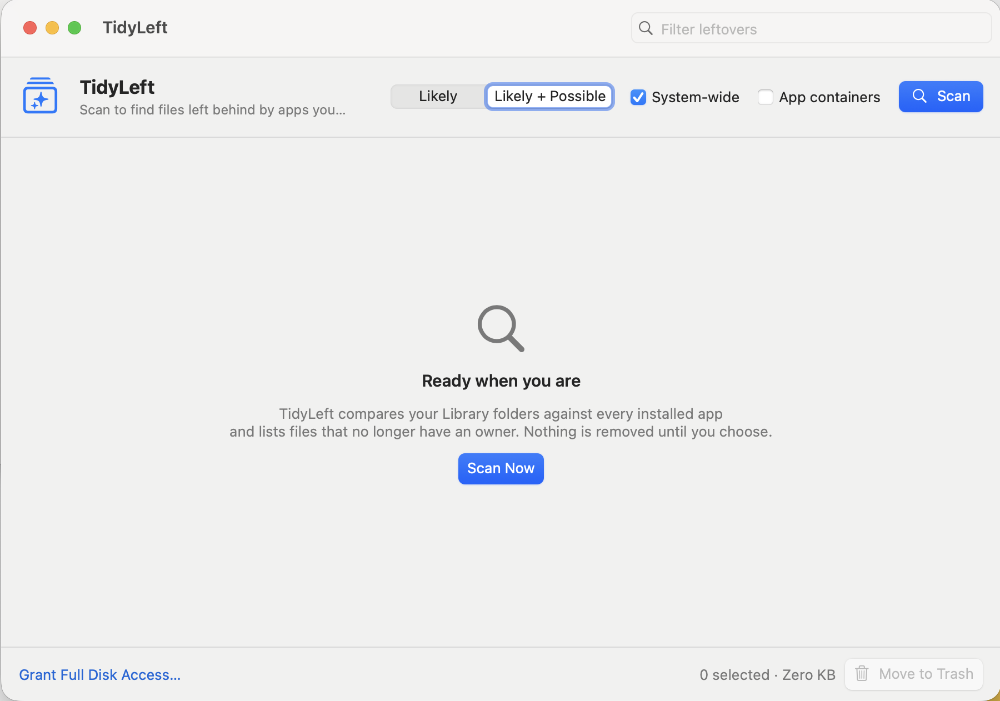

# TidyLeft: Mac Leftover Cleaner

> **⚠️ Disclaimer: use at your own risk.** I built TidyLeft for my own Mac, with the help of Claude (an AI assistant), because I wanted a free tool for this. I'm sharing it in case it's useful to others, but it comes with no warranty and no support, and I'm not responsible for any data loss or damage to your system. Review what it lists before removing anything, and keep a backup (for example Time Machine). Removed items go to the Trash, so check it before you empty it.

TidyLeft is a free, open-source Mac cleaner. It finds the files uninstalled apps leave behind, uninstalls apps completely, clears developer caches, shows what's using space, and fixes broken app settings, without touching macOS system files. Everything you remove goes to the Trash first.

It's a native SwiftUI app for macOS 14 and later, on Apple Silicon and Intel. [Download the latest DMG](https://github.com/seanay-sys/tidyleft/releases/latest).



## What it does

| Section | What it cleans |
| --- | --- |
| **Leftovers** | Preferences, caches, containers, launch agents and helper tools left by apps you already deleted. |
| **Uninstall Apps** | Removes an app *and* everything it installed (settings, caches, containers, background services, helpers) in one step. It quits the app first. Files that other apps from the same developer may share are left unticked. |
| **Developer Junk** | Xcode derived data, device support files and simulator caches, plus Homebrew, npm, Yarn, pnpm, Bun, pip, CocoaPods, Carthage, Gradle, Maven, Cargo, Go and Composer caches, and VS Code and JetBrains caches. All of it is rebuilt or re-downloaded when needed. |
| **Disk Usage** | A TreeSize-style size browser: biggest folders first, with size bars and percentages. Click into folders to drill down. It opens on app caches, and you can scan your home folder or any folder you choose. Caches and logs can be removed; your main folders, app libraries and anything belonging to macOS are locked. |
| **Broken Settings** | Third-party preference files that are damaged, empty, or owned by another user (for example after running an app with `sudo`). These can make apps crash at launch or forget their settings. Resetting moves the file to the Trash, and the app starts fresh. |

## Install

Download the latest DMG from [Releases](https://github.com/seanay-sys/tidyleft/releases/latest), or use Homebrew:

```bash
brew tap seanay-sys/tap
brew trust seanay-sys/tap
brew install --cask tidyleft
```

## Build & run

```bash
./build.sh
open "build/TidyLeft.app"
```

Needs only the Xcode Command Line Tools (macOS 14+). The app icon is drawn in code by `scripts/make-icon.swift`. Run `scripts/make-icns.sh` after changing it to regenerate `Resources/AppIcon.icns`. For a dry run that prints a report without changing anything:

```bash
"build/TidyLeft.app/Contents/MacOS/TidyLeft" --report --containers
```

To check whether the safety policy would ever allow removing a path:

```bash
"build/TidyLeft.app/Contents/MacOS/TidyLeft" --check-safety ~/Library/Preferences/com.apple.finder.plist
```

Dry runs for the other sections (they print what would be offered and never move anything): `--list-apps`, `--related "App Name"`, `--dev-junk`, `--broken-settings`, `--disk-usage ~/Library/Caches`, and `--check-paths PATH…`, which shows which rule applies to each path.

After a scan, **Select all leftovers** ticks everything currently shown (it follows the Likely/Possible filter and search). Hidden items are never removed.

## How Leftovers decides something is a leftover

1. **Builds an index of installed software**: every `.app` in `/Applications`, `~/Applications`, `/System/Applications`, CoreServices, plus anything Spotlight knows about (except in the Trash). It records bundle IDs (including embedded helpers, extensions, and frameworks), app names, code-signing team IDs, app-group entitlements, running apps, and Homebrew/CLI tool names.
2. **Scans** `~/Library` (Application Support, Caches, Preferences, Saved Application State, HTTPStorages, WebKit, Cookies, Logs, Application Scripts, LaunchAgents, and optionally Containers and Group Containers) and, with **System-wide** on, `/Library` (Application Support, Caches, Preferences, Logs, LaunchAgents, LaunchDaemons, PrivilegedHelperTools).
3. **Rates each entry**:
   - **Likely leftover**: a bundle ID from a developer with no installed apps, or a launch agent/daemon whose program no longer exists. These are pre-selected.
   - Launch daemons and helper tools that still exist but whose app is gone are rated **Possible**.
   - **Possible leftover**: the same developer has other apps installed, it's shared SDK data, or it was modified in the last week.
4. **Third-party only.** A safety policy ([SafetyPolicy.swift](Sources/TidyLeft/SafetyPolicy.swift)) runs during the scan and again right before anything is moved. It refuses:
   - Apple identifiers in any form (`com.apple.*`, `group.com.apple.*`, `TEAMID.groups.com.apple.*`, Shortcuts/TV legacy IDs, `.GlobalPreferences`) and bundled OS components (CUPS, OpenSSH, Kerberos…)
   - anything outside the scanned Library folders, or under `/System`, `/usr`, `/bin`, `/sbin`, `/private`, `/Library/Apple`
   - SIP-restricted or immutable files, and code signed by Apple itself
   - launch agents/daemons with an Apple label or an Apple-signed / system-path program
   - outside Application Support, any name that isn't a third-party bundle ID (for example UUID folders)
   - folders matched only by a loose name guess. A name folder is listed only when it joins a third-party bundle-ID group (for example `CrossOver` → `com.codeweavers.CrossOver`).

Items go to the **Trash**, so you can put them back. System-wide items (🔒) are moved with one macOS administrator prompt; launch agents and daemons are unloaded (`launchctl bootout`) first, and the moved files are re-owned by you so the Trash can be emptied normally. Grant Full Disk Access (there's a link in the app) to clean protected folders without permission prompts.

## Sharing

```bash
scripts/make-dmg.sh
```

This writes `dist/TidyLeft-<version>.dmg`, which holds the app (Apple Silicon and Intel), an Applications shortcut for drag-to-install, and a "Read Me First" note. The build is ad-hoc signed, not notarized, so on first launch recipients have to allow it under **System Settings → Privacy & Security → Open Anyway**. Removing that step needs an Apple Developer ID ($99/year), then `codesign --sign "Developer ID Application: …" --options runtime` and `xcrun notarytool submit`.

## License

MIT. See [LICENSE](LICENSE).

## Support

If this saved you some disk space, you can [buy me a coffee on Ko-fi](https://ko-fi.com/seanaysys) ☕. It's a thank-you, not a purchase: the app stays free and comes with no support or warranty. The app also has a small **Buy me a coffee** link in the sidebar and the About window, and mentions it after a cleanup that frees 500 MB or more. It only opens the Ko-fi page in your browser; TidyLeft never handles payments or sends any data.
